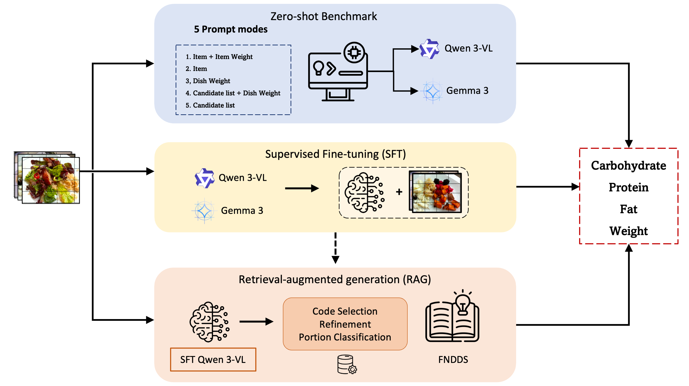

# Food Image Nutrition Estimation with Open-Weight Large Multimodal Models
This repository contains code for the manuscript "Food Image Nutrition Estimation with Open-Weight Large Multimodal Models: Fine-Tuning, Multi-View Ensembles, and Retrieval Augmentation". This project explores the application of open-weight Large Multimodal Models (LMMs) for food image nutrition estimation, with three learning paradigms (zero-shot benchmarks, supervised fine-tuning (SFT), and retrieval-augmented generation (RAG)). Using Gemma3-4B/12B and Qwen3-VL-4B/8B on two datasets, this study evaluated multiple configurations with a hierarchical diagnostic of knowledge, identification, and portion estimation.

## Data availability
This project is based on nutrition images from \hyperlink{https://huggingface.co/datasets/mmathys/food-nutrients}{Nutrition5k} and \hyperlink{https://skynet.ecn.purdue.edu/~coburn6/ACETADA/}{ACETADA}. 

## Model access
This project uses [Qwen3-VL-4B-Instruct](https://huggingface.co/Qwen/Qwen3-VL-4B-Instruct), [Qwen3-VL-8B-Instruct](https://huggingface.co/Qwen/Qwen3-VL-8B-Instruct), [Gemma-3-4B-IT](https://huggingface.co/google/gemma-3-4b-it), and [Gemma-3-12B-IT](https://huggingface.co/google/gemma-3-12b-it) from Hugging Face Hub.

